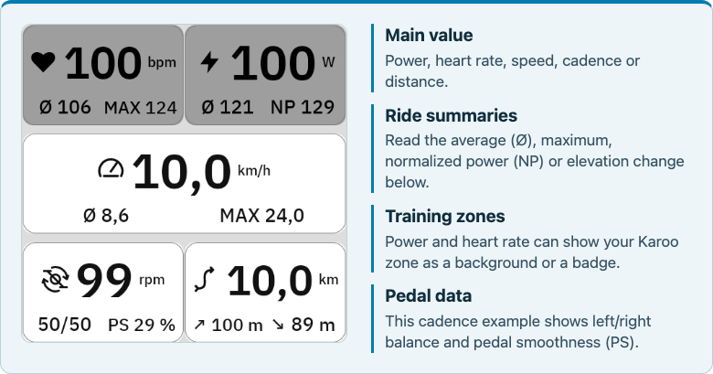
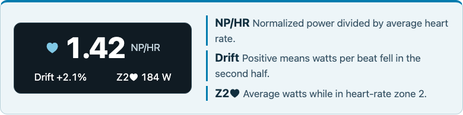
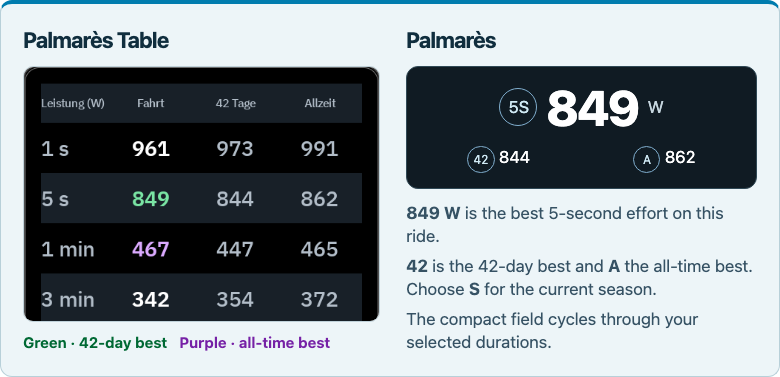
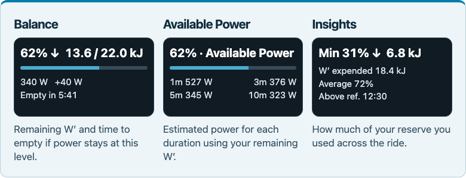

# kEtape for Hammerhead Karoo

kEtape adds compact ride metrics, power bests and W′ reserve estimates to your Karoo data pages.

**[Download the latest APK](https://github.com/jlojkasek/ketape/releases/latest)**

[Stacked Fields](#stacked-fields) · [Palmarès](#palmarès) · [Réserve](#réserve) · [Installation](#installation-and-updates) · [What's new](#whats-new)

## Stacked Fields

See a main reading and its ride summaries in the same data field. The screenshots and illustrations in this guide use sample data.

| Field | Main reading | Smaller readings |
| --- | --- | --- |
| Power | Watts | Ride average and normalized power (NP) |
| Heart Rate | Beats per minute | Ride average and maximum |
| Speed | Speed in km/h or mph (e.g. 32.2 km/h or 20.0 mph) | Ride average and maximum in the same unit |
| Distance | Distance in km or mi (e.g. 16.1 km or 10.0 mi) | Elevation gained and lost in m or ft (e.g. 305 m or 1,000 ft) |
| Cadence | rpm | Ride average and maximum in Classic. Compatible pedal sensors can add left/right balance, pedal smoothness and torque effectiveness. |
| Ride Load | Training Stress Score (e.g. 64 TSS) | Calories burned from power (e.g. 684 kcal) and Intensity Factor (e.g. 0.80 IF) |

Speed and distance use the Karoo's distance setting. Ascent and descent use its separate elevation setting. With Mixed units, you can see miles and metres together. You can smooth the main reading for power, heart rate, speed and cadence. Power and heart rate can show the zone from your Karoo profile as a background color or a small badge. [Cadence and pedal layouts](docs/pedal-fields.md#usage-english)

### Endurance

Endurance puts normalized power divided by average heart rate in the main row. The smaller readings show average watts in your Karoo heart-rate zone 2 and drift between the two halves of the ride.

Drift appears after 20 minutes of paired power and heart-rate data. Positive drift means the watts-per-beat ratio fell. Pauses are excluded. If the extension restarts mid-ride, drift and the zone 2 average are available again on the next full ride. Compare drift across steady rides of similar duration and conditions.

NP/HR uses the Karoo's ride summaries, which can cover different samples when a sensor drops out. The zone 2 average includes valid zero-watt readings.

## Palmarès

Compare your best power for each selected duration. **Palmarès** cycles through durations in one compact field. **Palmarès Table** shows several durations together, with the ride best alongside your benchmarks.

Both fields show your current ride bests. Connect Intervals.icu to add benchmarks. In the **Palmarès** tab, select one or two periods for both fields: current season (S), last 42 days (42), or all time (A). In the table, a new **42-day best** turns the ride value green and a new **all-time best** turns it purple. Purple takes priority if both records are beaten. The colors clear at ride end. An asterisk (`*`) marks ride bests recorded since the extension restarted. A dagger (`†`) marks references more than 48 hours old.

## Réserve

Réserve estimates your remaining W′, the amount of work available above your reference power. It uses power-meter readings to model depletion above that reference and recovery below it.

| Field | What it shows |
| --- | --- |
| **Balance** | Remaining W′ as a percentage and, in larger layouts, in kJ. See whether it is falling or recovering, with a time estimate when available. |
| **Available Power** | Theoretical sustained power for several durations, estimated from your remaining W′. |
| **Insights** | The lowest and average reserve during the ride, W′ expended and, in larger layouts, time above reference power. |

Set critical power (CP) and W′ manually, or import cycling FTP and W′ from Intervals.icu. Treat the displayed values as pacing estimates.

## Installation and updates

1. Download the APK from the [latest release](https://github.com/jlojkasek/ketape/releases/latest). On a Karoo that supports Companion sideloading, share the direct APK link with the [Hammerhead Companion app](https://support.hammerhead.io/hc/en-us/articles/31576497036827-Companion-App-Sideloading). On Karoo 2, install the APK with ADB.
2. Open kEtape to choose your settings and, if needed, connect Intervals.icu or set up Réserve.
3. Edit a data page in your Karoo ride profile and add the fields from **kEtape**.

Install updates over your existing copy to keep your settings and field layouts. [Update manifest](https://github.com/jlojkasek/ketape/releases/latest/download/manifest.json)

kEtape supports English and German. The data fields follow the Karoo's light or dark mode.

## Intervals.icu and offline use

In **General**, connect with a personal Intervals.icu API key. kEtape stores the key encrypted on the Karoo and uses it for read-only access to benchmarks and cycling parameters.

kEtape refreshes the references after a Karoo restart when the device is online and idle, with up to three attempts. During normal use, it checks for updates while idle and waits a day before automatically retrying a failed refresh. The last downloaded values are available offline. See the last refresh in **Palmarès** or **Réserve**.

## What's new

### 1.1.10 · Karoo units

- **Speed** and **Distance** follow the Karoo's distance and elevation settings, including Mixed units.

### 1.1.9 · Ride Load

- **Ride Load** combines the current ride's TSS, calories burned from power, and Intensity Factor in one field. It uses the Karoo's ride values and shows a dash for any unavailable reading.
- The kEtape details in the Karoo Extensions Library include three portrait previews of Stacked Fields, Palmarès, and Réserve.

### 1.1.8 · Settings and sync

- Data fields follow the Karoo display mode. **General** also offers a confirmed reset to default settings.
- Update your Intervals.icu key directly. kEtape keeps saved values when it verifies the same account.
- Both Palmarès fields can show one or two benchmarks from the current season, the last 42 days and all time. Palmarès Table highlights new records for the current ride.
- Palmarès benchmarks and imported Réserve parameters refresh after a Karoo restart once the device is online.

[Full 1.1.8 notes](releases/1.1.8.md)

### 1.1.7 · Endurance

Added [Endurance](#endurance) with NP/HR, drift and average power in heart-rate zone 2.

[All releases](https://github.com/jlojkasek/ketape/releases)
